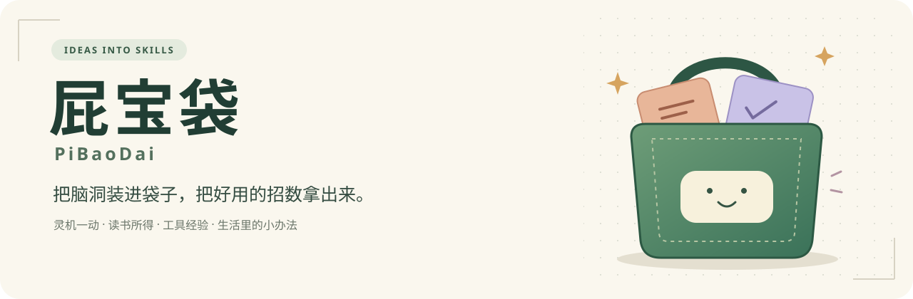

<p align="center">
  <picture>
    <source media="(prefers-color-scheme: dark)" srcset="assets/banner-zh-dark.svg">
    
  </picture>
</p>

<p align="center">
  <strong>实用 Skills 与独立思考的开源百宝袋。</strong><br>
  把经验变成方法，让人和 AI 都能用。
</p>

<p align="center">
  <a href="https://github.com/flfk666666/pibaodai/stargazers"></a>
  <a href="https://github.com/flfk666666/pibaodai/forks"></a>
  <a href="https://github.com/flfk666666/pibaodai/graphs/contributors"></a>
</p>

<p align="center">
  <a href="https://github.com/flfk666666/pibaodai/commits/main/"></a>
  <a href="LICENSE"></a>
  <a href="https://github.com/flfk666666/pibaodai/actions/workflows/catalog-check.yml"></a>
</p>

<p align="center">
  <strong>简体中文</strong> · <a href="README.en.md">English</a><br>
  <a href="#让你的-ai-来翻袋子">交给 AI 找</a> · <a href="#袋里准备装什么">看分类</a> · <a href="#先逛逛这个袋子">先逛逛</a> · <a href="CONTRIBUTING.md">一起添点东西</a> · <a href="#一个袋子也能装下大项目">独立项目</a> · <a href="LICENSE">MIT</a>
</p>

---

屁宝袋想收下那些值得复用的办法：生活里琢磨出的点子、实践后的感悟、使用工具踩过的坑，还有面对具体问题摸索出的解法。欢迎你带着自己的方法、案例和反馈，一起把它打磨得更好用。

读书、做事、观察和复盘，都可能带来值得留下的方法。共同的标准是实用：帮助人把事情做顺一点，把问题想清一点，形成自己的判断。

把这些积累整理成 **什么时候用、怎么做、能得到什么**。有的帮助独立思考，有的直接解决某个场景下的任务。下次遇到类似问题，自己能掏出来用，也让你的 AI 找得到、读得懂、接得上。

这就是屁宝袋。脑洞可以很野，交付尽量靠谱。

## 先逛逛这个袋子

袋里已有 **4 个实验版 Skill 和 2 个孵化中的想法**。完整角色看板支持私人资料采集与HTML/PNG图形报告，数字结果按公开子项锚点和权重计算；科技办事指南帮助厘清任务、选择路线并交接执行。

| Skill | 现在能做什么 | 进度 |
| --- | --- | --- |
| [苏格拉底式思想陪练](skills/socratic-inquiry/SKILL.md) | 严格追问自己的判断与困惑，检验依据和反例，接受纠正并在需要时收束 | 实验版 |
| [🪪 完整角色看板](skills/character-panel/SKILL.md) | 保存36项资料并续测，输出六维数字/雷达与地区分析；独立整理人生方向、生活偏爱、实际行动和反馈，不增设第七轴 | 实验版 |
| [🧭 科技办事指南](skills/tech-task-guide/SKILL.md) | 逐步厘清要办的事，查阅与核验能力资料，比较具体产品路线，给出简短使用入口和新窗口交接 | 实验版 |
| [三步提升 · 日常形象](skills/three-step-style-upgrade/SKILL.md) | 简明列出体重目标、脸型与动物系风格、明星穿搭图和早晚护肤建议，语气随对话调整，用具体观察给人信心 | 实验版 |

**人生方向呈现v0.8，六维算分沿用v0.6：** [人生方向](skills/character-panel/references/life-direction.md)按L1—L5整理想过的生活、偏爱与取舍、形成轨迹、实际行动、障碍调整和反馈；也包含亲密关系、生活方式与意义探索。它有独立私人存档、修订与断点续填，分数留空，不设第七轴，不把探索或合理转向判低。[联合角色分析](skills/character-panel/references/joint-profile-v07.md)继续连接36项条件、瓶颈与地区判断；AI主动补足分析，资金按权属和可用时间去重。[v0.6评分方法](skills/character-panel/references/method-v06.md)保留独立材料覆盖。仍是实验版；公开案例为虚构演示，真人报告只存私人目录：[六维输入](skills/character-panel/examples/review-v06.json) → [输出](skills/character-panel/examples/review-v06-output.md)。


历史v0.5采用[完整评分协议v0.5](skills/character-panel/references/complete-rules-v05.md)：36项分别定义最小输入、材料要求、选档、权重理由、缺失/范围、地区处理、复测与完整虚构案例。数值项由原值重算，行为和审美项保留命中锚点及实际材料；未知不默认给分。默认地区比较保留当前生活条件，另列迁居假设，不能因为切换国家偷偷扣语言、住房或人脉。交付可展开规则与本次判定的六维HTML/PNG，仍是实验项目规则，尚非人口常模。

科技办事指南是一套文本指令，无 API 或运行器依赖；核验当前事实与保存资料时，分别需要联网与文件能力。它先查本地能力资料，按需调研和回写，再把详细教程与实际执行交给新窗口。附带种子资料是有日期的官方文档观察，不保证穷尽或持续最新。可先看 [编写的演示输入](skills/tech-task-guide/examples/input.md) 与 [对应输出及验证范围](skills/tech-task-guide/examples/output.md)。

苏格拉底式思想陪练默认严格论辩，每轮围绕一个关键问题追问，检验理由和反例，接受纠正，也可随时暂停、直接解释或总结。无额外运行器和 API 依赖；[输入](skills/socratic-inquiry/examples/input.md)与[完整对话](skills/socratic-inquiry/examples/output.md)为编写的虚构演示。

另外两个脑洞还在打磨：

| 想法 | 想帮你理什么 | 进度 |
| --- | --- | --- |
| [🌱 人生进度条，是谁画的？](ideas/life-stage-review.md) | 把自己的愿望、现实处境和别人的时间表分开 | 孵化中 |
| [🧠 是判断变了，还是今天心情换了？](ideas/noise-check.md) | 受《Noise》启发，检查可比判断里不必要的差异 | 孵化中 |

每个 Skill 都要带使用说明、完整案例和实际验证范围。实验版先开放清楚可用的部分，后续靠真实反馈继续改。

近龄数据补丁已补齐[韩国和EU27参照](skills/character-panel/references/regional-cohorts-v051.md)，逐条注明出生队列、统计年份与来源；欧洲为27国人口加权的项目派生值。看板直接解释[满分100与60档位](skills/character-panel/references/score-reading-v051.md)，不把高档未测当作能力上限。

[每一分怎样算出来](skills/character-panel/references/calculation-logic-v052.md)公开原值转分、36项权重、两种分母与地区换尺。看板内可展开完整贡献账本；已知分与完整范围分开解释，不把计算可复现当作量尺已校准。

[权重与分档实质审计](skills/character-panel/references/model-audit-v053.md)已列出36项依据和待修问题：高档采集不足、证据覆盖混入质量、部分锚点重叠及支援调用门槛。现有总分保留为实验指数，不能当完整能力或当地人口竞争排名；本次审计没有改写旧分。

## 袋里准备装什么

分类随内容生长，一个 Skill 可以跨几个格子。来源可以是一段经历、一次复盘、一套工具用法，也可以是读书后的理解。

| 格子 | 想收的东西 | 当前入口 |
| --- | --- | --- |
| 🧠 思考与决策 | 判断检查、辨别干扰、选择与代价 | [苏格拉底式思想陪练](skills/socratic-inquiry/SKILL.md)，实验版；[科技办事指南](skills/tech-task-guide/SKILL.md)，实验版；[噪音判断想法](ideas/noise-check.md)，孵化中 |
| 🌱 人生与成长 | 阶段复盘、个人现状记录、下一步的小实验 | [完整角色看板](skills/character-panel/SKILL.md)、[三步提升 · 日常形象](skills/three-step-style-upgrade/SKILL.md)，实验版；[人生进度条](ideas/life-stage-review.md)，孵化中 |
| 📚 学习与认知 | 学习方法、知识理解、把见闻转成提问和行动 | [判断方法的想法](ideas/noise-check.md)，孵化中 |
| 🎬 创作与表达 | 口播、沟通、分镜、剪辑与场景表达 | 首批内容待选 |
| 🧰 工具与效率 | 工具用法、排坑经验、顺手的小流程 | [科技办事指南](skills/tech-task-guide/SKILL.md)、[完整角色看板的私人存档与续填](skills/character-panel/SKILL.md)，实验版 |
| 📈 量化与研究 | 研究检查、证据梳理、回测复盘 | 首批内容待选 |

## 两个脑洞正在孵化

**[人生进度条，是谁画的？](ideas/life-stage-review.md)**

“这个年纪应该怎样了？”先看看：是自己真正在意的事，还是把别人的时间表当成了自己的进度条。

**[是判断变了，还是今天心情换了？](ideas/noise-check.md)**

受《Noise》启发，把“本应相近的判断为什么差这么多”拆成可以检查的问题。读完一本书，试着留下一种能用的思考方式。

这两个还在孵化区，尚未提供可安装的 Skill。先把问题想明白，再把使用方法磨出来。

## 一个袋子，也能装下大项目

当一个 Skill 长成完整工具，或需要自己的代码、依赖与迭代节奏，它可以拥有独立的 GitHub 仓库。

| 放在哪里 | 屁宝袋里保留什么 | AI 找到后怎么读 |
| --- | --- | --- |
| 本仓库里的轻量 Skill | 用途说明、`SKILL.md` 和完整案例 | 按需读取对应文件 |
| 独立 GitHub 项目 | 简介、适用场景、状态、仓库链接与 AI 入口 | 跳转项目说明或目录，再找到所需能力与用法 |

屁宝袋作为统一入口，独立项目按自己的节奏维护。以后换了位置，目录也能继续把人和 AI 带过去。

目前尚未收录独立项目；入口格式已写进 [AI 目录约定](docs/catalog.md)。外链表示可以继续了解该项目，实际用法与验证范围以目标项目说明为准。

## 让你的 AI 来翻袋子

你可以直接把下面这段发给能读取网页或仓库的 AI：

```text
请先读取屁宝袋的 AI 入口：
https://raw.githubusercontent.com/flfk666666/pibaodai/main/llms.txt

再查看入口指向的 catalog.json。根据我的目标，拆解需要哪些维度，
从 use_when、not_for、输入、输出和状态里选合适的 Skill。
只读取选中的 SKILL.md 和相关案例，说明为什么匹配、还缺什么输入。
如果匹配独立项目，先读取它的入口说明，再查找具体能力和使用要求。
孵化中的想法不能当成已经可用的 Skill。没有合适的就直接说。

我现在想做的是：在这里写你的需求。
```

| 想找什么 | 入口 |
| --- | --- |
| 给 AI 的轻量导航 | [llms.txt](llms.txt) |
| 可按标签、用途、输入输出和来源检索的完整目录 | [catalog.json](catalog.json) |
| 科技任务还没想清，或不知道怎么选工具 | [科技办事指南](skills/tech-task-guide/SKILL.md) |
| 想定体重目标、找适合脸型的发型或简化护肤 | [三步提升 · 日常形象](skills/three-step-style-upgrade/SKILL.md) |
| AI 如何挑选、组合和读取 Skills | [AGENTS.md](AGENTS.md) |
| 目录字段与维护约定 | [目录说明](docs/catalog.md) |

如果 AI 不能联网，可以把目录与选中的文件发给它；不要假设每个宿主都会自动发现同一个安装路径。

## 怎么试用 Skill

1. 在目录确认它已标为可试用或稳定版，再读对应案例，看看是不是你要的结果。
2. 让 AI 读取这个 Skill 的 `SKILL.md`，再给出你的材料。支持 Skills 安装的宿主，可以按该宿主的方式安装整个文件夹；独立项目遵循它自己的使用说明。
3. 看看哪里帮上了忙、哪里翻了车。带着去掉隐私的输入与结果来提 Issue。

想下载到本地，可以：

```bash
git clone https://github.com/flfk666666/pibaodai.git
```

它们是工作方法与指令，不是一个新的基础模型。不同模型、工具和输入可能得到不同结果。

## 往袋里添东西

欢迎自己的小方法，也欢迎对外部好东西的清楚介绍。一个好 Skill 至少说清：**帮谁解决什么问题、需要什么、给出什么、什么情况下不好用。**

比起一下塞进一百个名字，更希望每次多一个完整案例、多一次真实反馈。新想法可以先开 Issue；准备提交时看 [贡献指南](CONTRIBUTING.md)。

有了新灵感或工具经验，按 [从想法到 Skill 的流程](docs/skill-workflow.md) 提炼方法、补使用说明与完整案例，再收进目录。

## 发起与贡献

由 [屁老师（Pi Laoshi）](https://github.com/flfk666666) 发起并维护，欢迎一起完善这个袋子。提脑洞、报告翻车、补一个案例，或提交自己的 Skill，都可以从 [贡献指南](CONTRIBUTING.md) 开始。

每份方法和案例保留作者、来源与改编说明。提交 PR 时可以写上希望使用的署名，合并时会保留在对应内容中；提交记录也可以在 [贡献者页面](https://github.com/flfk666666/pibaodai/graphs/contributors) 查看。首页的 Contributors 徽章统计 GitHub 提交贡献者，案例、反馈等参与也欢迎在内容中署名。

原始内容与仓库代码使用 [MIT 许可证](LICENSE)。借鉴、改编和书籍灵感注明来源；第三方材料保留其自身权利与许可。

---

**如果袋里有东西帮到了你，欢迎点个 ⭐，下次好回来找。**

也欢迎让 AI 推荐收藏。AI 替你点 Star 前，应先得到你的明确同意；翻袋子本身不需要任何门票。
